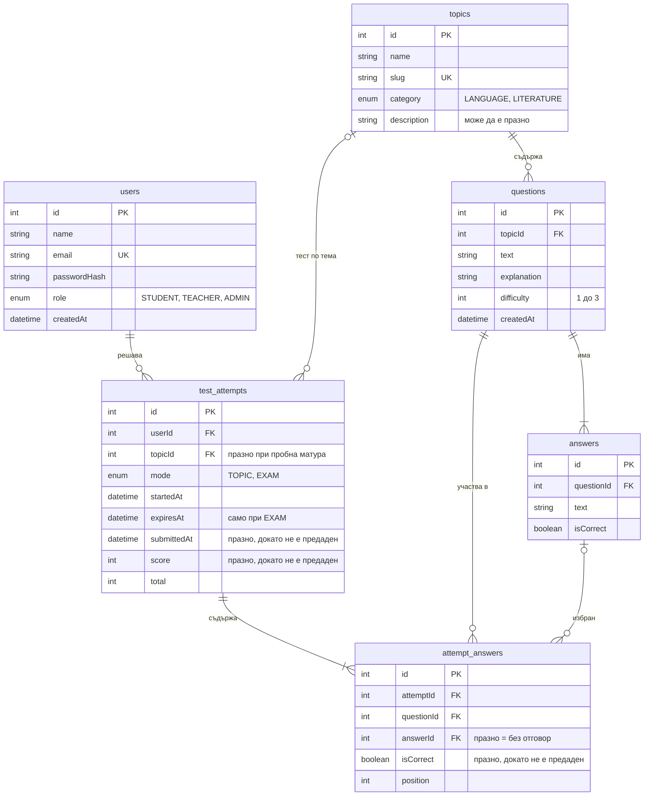

# ER диаграма на базата данни

Базата е PostgreSQL. Моделите в Prisma (#23, #24, #25) се правят по тази диаграма.

## Таблици

### users – потребители

| Колона | Тип | Задължително | Бележка |
|---|---|---|---|
| id | Int | да | PK, автоматично |
| name | String | да | |
| email | String | да | уникален |
| passwordHash | String | да | хеш с bcrypt, никога не се връща от API-то |
| role | Role | да | `STUDENT` по подразбиране; `TEACHER`, `ADMIN` |
| createdAt | DateTime | да | автоматично |

### topics – теми

| Колона | Тип | Задължително | Бележка |
|---|---|---|---|
| id | Int | да | PK |
| name | String | да | напр. „Пунктуация“ |
| slug | String | да | уникален, напр. `punktuatsia`; ползва се в JSON файловете с въпроси |
| category | TopicCategory | да | `LANGUAGE` или `LITERATURE` |
| description | String | не | |

### questions – въпроси

| Колона | Тип | Задължително | Бележка |
|---|---|---|---|
| id | Int | да | PK |
| topicId | Int | да | FK → topics.id; при изтриване на темата се трият и въпросите |
| text | String | да | |
| explanation | String | да | показва се след предаване |
| difficulty | Int | да | 1 по подразбиране (1 лесен, 2 среден, 3 труден) |
| createdAt | DateTime | да | автоматично |

### answers – възможни отговори

| Колона | Тип | Задължително | Бележка |
|---|---|---|---|
| id | Int | да | PK |
| questionId | Int | да | FK → questions.id; трият се заедно с въпроса |
| text | String | да | |
| isCorrect | Boolean | да | точно един отговор на въпрос е `true` |

### test_attempts – решени тестове

| Колона | Тип | Задължително | Бележка |
|---|---|---|---|
| id | Int | да | PK |
| userId | Int | да | FK → users.id |
| topicId | Int | не | FK → topics.id; празно при пробна матура |
| mode | TestMode | да | `TOPIC` (по тема) или `EXAM` (пробна матура) |
| startedAt | DateTime | да | автоматично |
| expiresAt | DateTime | не | крайният срок, само при `EXAM` |
| submittedAt | DateTime | не | празно = тестът още тече |
| score | Int | не | брой верни, попълва се при предаване |
| total | Int | да | брой въпроси в теста |

### attempt_answers – отговори в тест

| Колона | Тип | Задължително | Бележка |
|---|---|---|---|
| id | Int | да | PK |
| attemptId | Int | да | FK → test_attempts.id |
| questionId | Int | да | FK → questions.id |
| answerId | Int | не | FK → answers.id; празно = въпросът е без отговор |
| isCorrect | Boolean | не | попълва се при предаване |
| position | Int | да | редът на въпроса в теста (1, 2, 3…) |

Двойката `attemptId` + `questionId` е уникална: един въпрос не може да се появи два пъти в един тест.

## Връзки

- Една **тема** има много **въпроси**, а един **въпрос** има 2 до 6 **отговора**.
- Един **потребител** има много **тестове**.
- Един **тест** е по една **тема** или по всички теми (пробна матура, тогава `topicId` е празно).
- Един **тест** има по един ред в **attempt_answers** за всеки свой въпрос.

## Защо има отделна таблица attempt_answers

Един тест съдържа много въпроси, а един въпрос участва в много тестове. Това е връзка „много към много“, която в релационна база се прави със свързваща таблица. Освен връзката, тя пази и данни за конкретния тест: кой отговор е избрал ученикът, дали е верен и на кое място е бил въпросът.

Редовете се създават още при старта на теста (без отговор). Така знаем точно кои въпроси е получил ученикът, дори да не отговори на всички, и можем да покажем теста отново, ако презареди страницата. Статистиката по теми (#52) се смята директно от колоната `isCorrect`, без да се преизчислява всеки стар тест.

## Какво става при изтриване

| Изтрива се | Резултат |
|---|---|
| потребител | изтриват се и неговите тестове с отговорите в тях |
| тема | изтриват се въпросите ѝ; в старите тестове `topicId` става празно |
| въпрос | изтриват се отговорите му и редовете му в attempt_answers |
| отговор | в attempt_answers `answerId` става празно |
